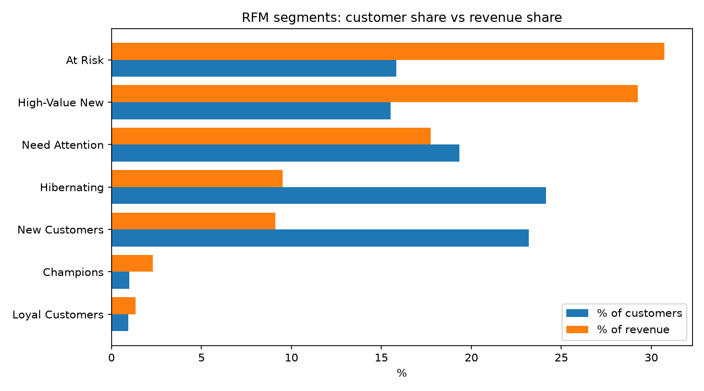
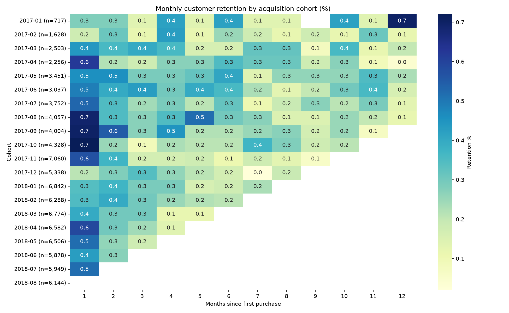

# Sales & Customer Analytics Pipeline (Olist E-Commerce)

An end-to-end analytics project on the [Olist Brazilian E-Commerce dataset](https://www.kaggle.com/datasets/olistbr/brazilian-ecommerce): a Python ETL loads ~100K orders into PostgreSQL, SQL views power the revenue and customer KPIs, Python handles RFM segmentation and cohort retention, and a Power BI dashboard presents the results.

**Tech stack:** Python (Pandas, SQLAlchemy) · PostgreSQL · SQL (CTEs, joins, window functions) · Power BI

---

## Key Results

| Metric | Value |
|---|---|
| Delivered orders | 96,478 |
| Revenue (BRL) | 13.22M |
| Customers analysed | 93,358 |
| Average order value | 137.04 |
| Average review score | 4.08 / 5 |
| Late deliveries | ~8% |
| Average delivery time | 12.5 days |
| Top states by revenue | SP, RJ, MG |
| Top categories by revenue | Health Beauty, Watches Gifts, Bed Bath Table |
| Top RFM segment | At Risk (30.74% of revenue from 15.84% of customers) |
| At-risk customers | 14,784 (30.74% of revenue) |
| Month-1 retention | X.XX% |

*Revenue = item price on delivered orders, excluding freight.*

### Key Insights

- **At-risk customers are the largest revenue pool.** 14,784 customers (15.84% of the base, average 443 days since their last order) generate 30.74% of revenue, so win-back campaigns target the biggest opportunity.
- **High-Value New customers are a close second** at 29.25% of revenue (15.51% of customers). They are recent, big-basket buyers who have ordered once, so converting them into repeat buyers is the clearest growth lever.
- **Champions are rare.** Repeat, recent, high-spend customers are 1.00% of customers and 2.31% of revenue, which shows how thin repeat purchasing is on the platform.
- **Revenue is geographically concentrated.** São Paulo (SP) is far ahead of every other state, followed by RJ and MG.
- **Month-1 retention is X.XX%**, confirming that most customers do not come back after their first order.

---

## Dashboard

**Overview**


**Product Category**


**Regional Performance**


---

## Customer Analysis (Python)

### RFM segments

| Segment | Customers | % Customers | Revenue (BRL) | % Revenue |
|---|---|---|---|---|
| At Risk | 14,784 | 15.84% | 4,064,668 | 30.74% |
| High-Value New | 14,481 | 15.51% | 3,867,673 | 29.25% |
| Need Attention | 18,064 | 19.35% | 2,347,234 | 17.75% |
| Hibernating | 22,559 | 24.16% | 1,257,987 | 9.51% |
| New Customers | 21,661 | 23.20% | 1,202,584 | 9.10% |
| Champions | 931 | 1.00% | 305,122 | 2.31% |
| Loyal Customers | 878 | 0.94% | 176,230 | 1.33% |



### Cohort retention



---

## Architecture

```
Kaggle CSVs
   │
   ▼
src/etl.py  ── clean, normalize, validate (Pandas)
   │
   ▼
PostgreSQL (schema: olist, 7 tables)
   │
   ▼
sql/02_views.sql  ── 10 analytical views
   │
   ├──► src/rfm.py      ── RFM scoring and segments
   ├──► src/cohort.py   ── cohort retention matrix
   │
   ▼
Power BI dashboard
```

## Repository Structure

```
olist-analytics/
├── data/raw/              # Kaggle CSVs (not tracked)
├── docs/                  # dashboard screenshots
├── outputs/               # charts and CSV results
├── powerbi/               # dashboard (.pbix) and build guide
├── sql/
│   ├── 01_schema.sql      # tables, keys, indexes
│   └── 02_views.sql       # analytical views
├── src/
│   ├── config.py
│   ├── etl.py
│   ├── rfm.py
│   ├── cohort.py
│   └── export_for_powerbi.py
├── .env.example
├── requirements.txt
└── README.md
```

## ETL Highlights

- Fixes misspelled source columns and translates product categories to English
- Parses timestamps and derives `delivery_days`, `delivery_delay_days` and `is_late`
- Drops duplicates and rows that break referential integrity, and logs every removal
- Keeps the latest review per order, since `review_id` is not unique in the source
- Rebuilds the schema on each run, so the pipeline can be re-run safely

## SQL Views

| View | Purpose | Techniques |
|---|---|---|
| `vw_order_summary` | One row per order with KPIs | CTEs, joins |
| `vw_sales_fact` | Item-level fact table for Power BI | Joins |
| `vw_monthly_revenue` | Revenue, AOV, month-over-month growth | `LAG`, running `SUM OVER` |
| `vw_category_performance` | Rank, revenue share, Pareto | `RANK`, windowed `SUM` |
| `vw_state_performance` | Regional revenue and delivery KPIs | Window share |
| `vw_top_categories_by_state` | Top 3 categories per state | `ROW_NUMBER` |
| `vw_customer_kpis` | Per-customer orders and revenue | Aggregation |
| `vw_customer_order_sequence` | Days between repeat orders | `ROW_NUMBER`, `LAG` |
| `vw_rfm_base` | Recency, frequency, monetary inputs | CTE |
| `vw_cohort_retention` | Retention by acquisition month | `FIRST_VALUE`, `AGE` |

---

## Getting Started

**Prerequisites:** Python 3.10+, PostgreSQL 16, Power BI Desktop (optional)

```bash
# 1. Install dependencies
python -m venv venv
venv\Scripts\activate            # Mac/Linux: source venv/bin/activate
pip install -r requirements.txt

# 2. Configure the database connection
copy .env.example .env           # Mac/Linux: cp .env.example .env
# edit .env and set PG_PASSWORD

# 3. Create the database
psql -U postgres -c "CREATE DATABASE olist;"
```

Download the dataset from [Kaggle](https://www.kaggle.com/datasets/olistbr/brazilian-ecommerce) and place the CSVs in `data/raw/` (the geolocation file is not used).

```bash
python src/etl.py       # create schema, load tables, create views
python src/rfm.py       # RFM segmentation -> outputs/ and DB tables
python src/cohort.py    # cohort heatmap -> outputs/
```

To build the dashboard, follow [`powerbi/powerbi_guide.md`](powerbi/powerbi_guide.md) and open `powerbi/olist_dashboard.pbix`.

## Notes

- Most customers place only one order, so retention is low by nature, and RFM frequency uses fixed bins instead of quantiles.
- The dataset covers 2016 to 2018. Early 2016 and late 2018 have very few orders.